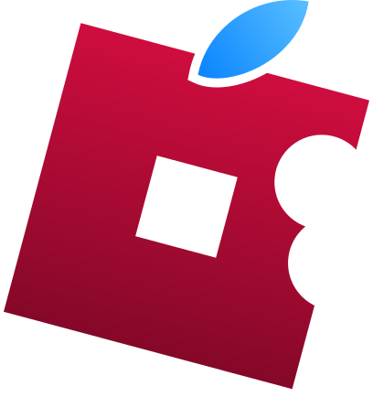

<div align="center">
  
  <h1>AppleBlox Native</h1>
  <p>A compact, native SwiftUI launcher for Roblox on macOS.</p>
  <p>
    <a href="https://github.com/Belligerently/appleblox-native/releases">Downloads</a> ·
    <a href="https://github.com/Belligerently/appleblox-native/tree/swiftui-foundation/native">Native source & documentation</a> ·
    <a href="https://github.com/Belligerently/appleblox-native/pull/1">Development PR</a>
  </p>
</div>

[](https://github.com/Belligerently/appleblox-native/actions/workflows/build.yml?query=branch%3Aswiftui-foundation)
[](LICENSE)

AppleBlox Native is an independent fork of [AppleBlox](https://github.com/AppleBlox/appleblox), rebuilding the launcher in SwiftUI with a smaller interface and native macOS controls. It keeps the original rose identity and apple-shaped Roblox mark, with a blue leaf to distinguish the fork.

> **Development preview:** Native development currently lives on [`swiftui-foundation`](https://github.com/Belligerently/appleblox-native/tree/swiftui-foundation) in [PR #1](https://github.com/Belligerently/appleblox-native/pull/1). `main` still contains the inherited application until that PR is merged. The features and build instructions below describe the native edition.

## Download

Get the native app from [this fork’s releases](https://github.com/Belligerently/appleblox-native/releases). Development builds are labeled **Pre-release**. Public versioning begins at **0.1.0**; a stable native release has not been published yet.

Packages include a **universal app for Apple Silicon and Intel**, available as a DMG or ZIP, plus SHA-256 checksums. Open the DMG and drag **AppleBlox Native** into Applications, or extract the ZIP and move the app there.

The app targets **macOS 14 or later**. Liquid Glass is used on macOS 26 and later, with material fallbacks on earlier versions. Intel and macOS 14 runtime testing are still outstanding. Builds are currently ad-hoc signed and **not Apple notarized**.

## What’s in the native app

| Feature | Included |
| --- | --- |
| Launcher | Roblox Player detection, saved games with artwork and search, per-game profiles, fixed-field diagnostics reports, and game-details cache cleanup |
| Interface | Compact navigation, Liquid Glass controls, System/Light/Dark themes, solid backgrounds, and reduced-motion support |
| Engine settings | Quality/distance and voxel-shadow presets, experimental Vulkan and temporary-display FPS workaround, visual flag editing with search and bulk removal, validated JSON import/export, and backup/restore |
| Content mods | Local packs with rescan/conflict reports, a mod guide, custom fonts, Roblox UI icon colors, Legacy Resolution launch mode, and resource restore |
| Player updates | Roblox LIVE version checks and validated downloads with previous-app retention |
| Accounts | Private website sign-in, explicit Player-login import, and Keychain-backed sessions |
| Integrations | Discord presence with visibility controls, optional artwork, opt-in Bloxstrap SDK game control, local play history, optional server-region lookups and native alerts, and opt-in launch-link handling |

This is an ongoing migration. The online mod workshop, server-region picker, a full online game browser, and some original appearance preferences remain to be ported. Authenticated account switching and live Discord display still need acceptance testing. Roblox may ignore individual engine flags or restrict multiple instances. Old lighting and general post-processing overrides are unavailable; the FPS display workaround is experimental and remains unverified on hardware.

The [native developer guide](https://github.com/Belligerently/appleblox-native/blob/swiftui-foundation/native/README.md) describes behavior, validation, and remaining work in detail.

## Build from source

Use **full Xcode 27 or later**, including its macOS SDK and Swift toolchain. Standalone Command Line Tools are insufficient for the app’s SwiftUI macros. The native app has no third-party Swift package dependencies and does not require Bun or Node.js.

```sh
git clone --branch swiftui-foundation https://github.com/Belligerently/appleblox-native.git
cd appleblox-native
bash native/test.sh
bash native/build.sh
open 'native/dist/AppleBlox Native.app'
```

To produce a universal app from the repository root:

```sh
APPLEBLOX_UNIVERSAL=1 bash native/build.sh
```

You can also open `native/Package.swift` in Xcode. The scripts select full Xcode when standalone Command Line Tools are active; set `DEVELOPER_DIR` to use another Xcode installation.

## Releases and versions

App-related pushes are tested and built automatically. Each successful app commit produces a release with versioned ZIP/DMG assets and checksums:

- **`main`:** stable versions `0.1.0`, `0.1.1`, `0.1.2`, … once the native app and workflow are merged.
- **Other branches:** prereleases such as `0.1.0-dev.1`, `0.1.0-dev.2`, … advancing toward the next stable patch.
- **Documentation-only changes:** no native release.

Native tags use the `native-v` prefix to keep this fork’s history separate from upstream. Release versions are written into the packaged app; the inherited `legacy/package.json` version belongs to the legacy application. See the [release guide](https://github.com/Belligerently/appleblox-native/blob/swiftui-foundation/.github/RELEASING.md) for retries, commit selection, and signing details.

## Data and integrations

Settings, imported mods, backups, and optional play history are stored locally. Saved Roblox sessions use macOS Keychain. Sign-in, game metadata, and Player updates contact Roblox services; enabling Discord presence shares the current game name and public game link with Discord. Optional server-location lookup sends the connected server’s public IP address to ipinfo.io; it defaults off. Server alerts require macOS notification permission. The native guide documents where data is stored and how optional features work.

## Contributing

Use this fork’s [pull requests](https://github.com/Belligerently/appleblox-native/pulls) for fixes and contributions. For bugs, include your macOS version, Mac architecture, app version, reproduction steps, and relevant diagnostics. Remove account/session information from anything you share.

The native implementation is in `native/`. The self-contained `legacy/` folder holds the inherited Svelte/Neutralino source, assets, tests, package files, and build configuration. See [the legacy notes](docs/LEGACY.md) when working on that code.

## Credits and license

AppleBlox Native retains the [GPL-3.0 license](LICENSE) and the work of **AppleBlox and its contributors**. Original logo by **@typeofnull**; the rose body and blue leaf adapt that mark for this fork. [Bloxstrap](https://github.com/pizzaboxer/bloxstrap) inspired the original project.

This is an independent fork, not an official AppleBlox release. Original project resources and legacy component credits are preserved in the [legacy notes](docs/LEGACY.md).
